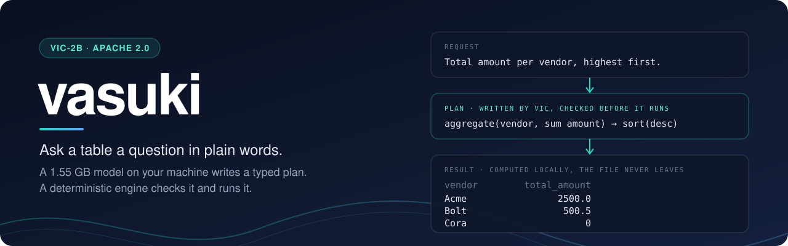
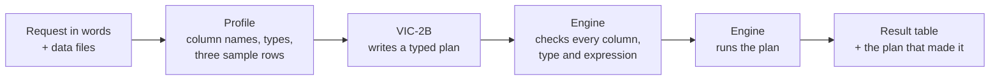

<p align="center">
  
</p>

<p align="center">
  <a href="https://github.com/rahul05ranjan/vasuki-vic/actions/workflows/ci.yml"></a>
  <a href="https://github.com/rahul05ranjan/vasuki-vic/releases"></a>
  <a href="LICENSE"></a>
  
  <a href="https://huggingface.co/rahul05ranjan/VIC-2B"></a>
  <a href="https://huggingface.co/rahul05ranjan/VIC-2B-GGUF"></a>
</p>

<p align="center">
  
[](https://m8ven.ai/mcp/rahul05ranjan/vasuki-vic?s=readme)

</p>

<p align="center">
  <a href="#quickstart">Quickstart</a> ·
  <a href="#benchmarks">Benchmarks</a> ·
  <a href="#integrations">Integrations</a> ·
  <a href="#security-and-data-handling">Security</a> ·
  <a href="#documentation">Documentation</a> ·
  <a href="https://huggingface.co/rahul05ranjan/VIC-2B">Model</a>
</p>

# vasuki

**Ask a data file a question in plain words and get the answer as a table, computed on your own machine.**

vasuki pairs a small language model with a deterministic engine. **VIC-2B**, a 1.55 GB model, reads your request and a short profile of each table, and writes a typed plan. The engine checks that plan against your columns and runs it. The model never does arithmetic, never writes code, and never sees the whole file.

```sh
uvx --from git+https://github.com/rahul05ranjan/vasuki-vic vasuki ask "Total amount per vendor, highest first." -i invoices.csv
```

## Why vasuki

| Property | What it means |
|---|---|
| **Local** | The model and the engine both run on your machine. The model is shown column names, types and a few sample values, never the whole file. |
| **Auditable** | Every answer comes with its plan: a short list of typed steps from 12 operations, which you can read, check and run again. |
| **Deterministic** | The engine runs plans, not generated code. Expressions are parsed and interpreted against a whitelist; nothing is passed to `eval`. |
| **Small and fast** | 1.55 GB on disk, well under a second per request on an Apple-silicon laptop once the model is loaded. |
| **Measured** | On questions real people wrote, VIC-2B plans as well as a 120B-parameter model given the full format description. See [Benchmarks](#benchmarks). |
| **Open** | Code and model are Apache 2.0. The eval sets, the benchmark harness and every result file are in this repository. |

## Quickstart

You need [uv](https://docs.astral.sh/uv/). Nothing else is installed by hand.

**Mac with Apple silicon.** The first run installs the program and downloads the model (1.55 GB, about two minutes). Later runs take a few seconds.

```sh
uvx --from git+https://github.com/rahul05ranjan/vasuki-vic vasuki ask "Total amount per vendor, highest first." -i invoices.csv
```

**macOS, Linux or Windows with [Ollama](https://ollama.com).** Add `--ollama`. The first run fetches the model into Ollama (2.0 GB).

```sh
uvx --from git+https://github.com/rahul05ranjan/vasuki-vic vasuki ask "Total amount per vendor, highest first." -i invoices.csv --ollama
```

The answer is one JSON object:

```json
{
  "status": "ok",
  "columns": ["vendor", "total_amount"],
  "row_count": 3,
  "rows": [["Acme", 2500.0], ["Bolt", 500.5], ["Cora", 0]]
}
```

Add `--show-plan` to see the plan the model wrote, and `-o out.csv` to save every row. Inputs can be `.csv`, `.tsv`, `.json` or `.jsonl`; give one `-i` per file, two for a join.

`status` tells you what happened:

| `status` | Meaning |
|---|---|
| `ok` | The plan ran. `rows` holds the first rows of the result |
| `needs_clarification` | The request cannot be planned without more information; `question` says what is missing |
| `unsupported` | The operations cannot express the request; `reason` says why |
| `failed` | The model's reply was not a plan that runs |

## How it works



A plan is JSON, a list of steps such as `filter`, `derive`, `aggregate` and `join`:

```json
{"status": "plan", "steps": [
  {"op": "aggregate", "group_by": ["vendor"], "metrics": [{"as": "total_amount", "fn": "sum", "column": "amount"}]},
  {"op": "sort", "by": [{"column": "total_amount", "order": "desc"}]}
]}
```

The whole plan is resolved against the input columns before any step runs, so a wrong column name fails at once and names the closest match. The engine imports nothing outside the Python standard library. Any planner can write plans for it: VIC, another model, or a person. The format is described in [docs/plan-format.md](docs/plan-format.md).

## Benchmarks

Each task is scored by running the model's plan and comparing the resulting table with the expected one, so any plan that gives the right table counts. VIC-2B is measured as shipped (6-bit, 1.55 GB). The reference is `gpt-oss-120b`, a 120B-parameter model, given the full format description with every request.

| Test set | Tasks | VIC-2B | Reference model |
|---|---:|---:|---:|
| Questions real people wrote, from Spider's validation split (`evals/real1`) | 681 | **83.0%** | 81.6% |
| The same kind from a second source, BIRD's dev split (`evals/real2`) | 195 | **66.7%** | 65.6% |
| Hand-written requests that spell out their output (`evals/test1`) | 173 | 82.1% | **93.6%** |
| Development set (`evals/v2`) | 245 | 85.7% | **97.1%** |

- On the first two sets the two models cannot be told apart statistically. Those rows ignore column names, because the questions name none.
- VIC-2B was trained on Spider's train split, so the BIRD row is the check that the Spider row is not familiarity with Spider's wording. None of BIRD was trained on.
- On requests that state exactly which columns to return and what to call them, the large model is ahead.
- VIC-2B reads about 685 tokens and writes about 77 per request on the BIRD set; the reference model needs 3,155 and 509, most of it the format description.

Every number can be reproduced: the eval sets are in [`evals/`](evals), the stored model answers in [`bench/results/`](bench/results), and the method in [docs/evaluation.md](docs/evaluation.md).

## Integrations

| Use it from | How |
|---|---|
| **Command line** | `vasuki ask`, `vasuki run`, `vasuki check`, `vasuki schema`. See [docs/usage.md](docs/usage.md) |
| **Python** | `from vasuki import run_plan, load_table` and `from vasuki.planner import MLXPlanner, ask`. See [docs/usage.md](docs/usage.md#from-python) |
| **Ollama** | `--ollama`. The model is also in the Ollama library as [`rahuul/vic-2b`](https://ollama.com/rahuul/vic-2b). See [docs/usage.md](docs/usage.md#ollama) |
| **Any OpenAI-style server** | `--url http://host/v1 --model NAME` (LM Studio, llama.cpp, vLLM, a hosted model) |
| **Coding agents** | `npx skills add rahul05ranjan/vasuki-vic` installs a skill for Claude Code, Codex, Cursor and others. See [docs/agents.md](docs/agents.md) |
| **MCP clients** | `vasuki-mcp`, a stdio server with four tools. See [docs/agents.md](docs/agents.md#mcp-server) |

## Security and data handling

- **What the model sees.** For each table: the row count, column names and types, null counts, three sample rows, and the distinct values of text columns that have twenty or fewer. It does not see the rest of the file.
- **Where it runs.** With the default model or `--ollama`, on your machine. With `--url`, that profile is sent to the server you name, so use a server you trust.
- **What the engine executes.** Plans only. `where` and `expr` use Python syntax but are parsed to a syntax tree and interpreted against a whitelist of operators and functions. There is no indexing, no slicing and no `eval`.
- **What it reads and writes.** The input files you name, and the output path you give. The MCP server reads any path a client hands it, with the permissions of whoever started it.
- **Network use.** vasuki sends no telemetry. The first run downloads the model from Hugging Face, or through Ollama.

Report a vulnerability privately: see [SECURITY.md](SECURITY.md).

## Limitations

- **Wrong answers are silent.** About one plain-language request in seven gets a plan that runs and returns the wrong table. Read the plan (`--show-plan`) when the answer matters; it is short and says exactly which rows and columns were used.
- **Scope.** Tabular work on files: filter, derive, rename, select, drop, cast, sort, deduplicate, aggregate, join, unit conversion and limit. No SQL sources, no time zones, no currency conversion, no charts.
- **Harder questions.** Questions that lean on what a column means, as BIRD's do, are right two times in three.
- **Agents that already run code.** A coding agent with Python on hand will usually write its own script. The skill is for when you ask for it by name, or want the data kept out of the agent's context.
- **Languages.** English, and Hinglish to a lesser degree.
- **Hardware.** The built-in runner needs a Mac with Apple silicon. Elsewhere, use Ollama or another server.

## Documentation

| Document | What it covers |
|---|---|
| [docs/usage.md](docs/usage.md) | Commands, options, exit codes, Ollama and other servers, the Python API |
| [docs/plan-format.md](docs/plan-format.md) | The response format, the operations, and engine behaviour worth knowing |
| [docs/agents.md](docs/agents.md) | The agent skill and the MCP server |
| [docs/evaluation.md](docs/evaluation.md) | The eval sets, how scoring works, and how to benchmark a model |
| [Model card](https://huggingface.co/rahul05ranjan/VIC-2B) | Training, evaluation and limits of VIC-2B |
| [CHANGELOG.md](CHANGELOG.md) | What changed in each release |

## Names

- **vasuki** is this package: the plan format, the engine and the eval harness. It works with any planner.
- **VIC** (Vasuki Indicus Compute) is the planner model trained to write this format. Models are named `VIC-<size>` by parameter count.

## Contributing

Issues and pull requests are welcome. [CONTRIBUTING.md](CONTRIBUTING.md) explains how to set up, test and propose a change. Please read the [Code of Conduct](CODE_OF_CONDUCT.md).

```sh
git clone https://github.com/rahul05ranjan/vasuki-vic && cd vasuki-vic
uv sync
uv run pytest
```

## Licence

The code and the VIC-2B model are released under the [Apache License 2.0](LICENSE). Three eval sets are derived from other people's datasets and keep those datasets' licence, CC BY-SA 4.0: `evals/real1` and `evals/real_dev` from Spider (Yu et al., 2018), and `evals/real2` from BIRD (Li et al., 2023). [NOTICE](NOTICE) has the details, including what the model was trained on.

## Citation

```bibtex
@software{vasuki_vic_2026,
  title  = {vasuki and VIC-2B: typed plans, a deterministic engine and a small planner model for tabular questions},
  author = {rahul05ranjan},
  year   = {2026},
  url    = {https://github.com/rahul05ranjan/vasuki-vic}
}
```

## Acknowledgements

VIC-2B is fine-tuned from [Qwen3.5-2B](https://huggingface.co/Qwen/Qwen3.5-2B) (Alibaba Cloud, Apache 2.0). The real-question eval sets come from [Spider](https://yale-lily.github.io/spider) and [BIRD](https://bird-bench.github.io). Local inference uses [MLX](https://github.com/ml-explore/mlx), [Ollama](https://ollama.com) and [llama.cpp](https://github.com/ggml-org/llama.cpp).
